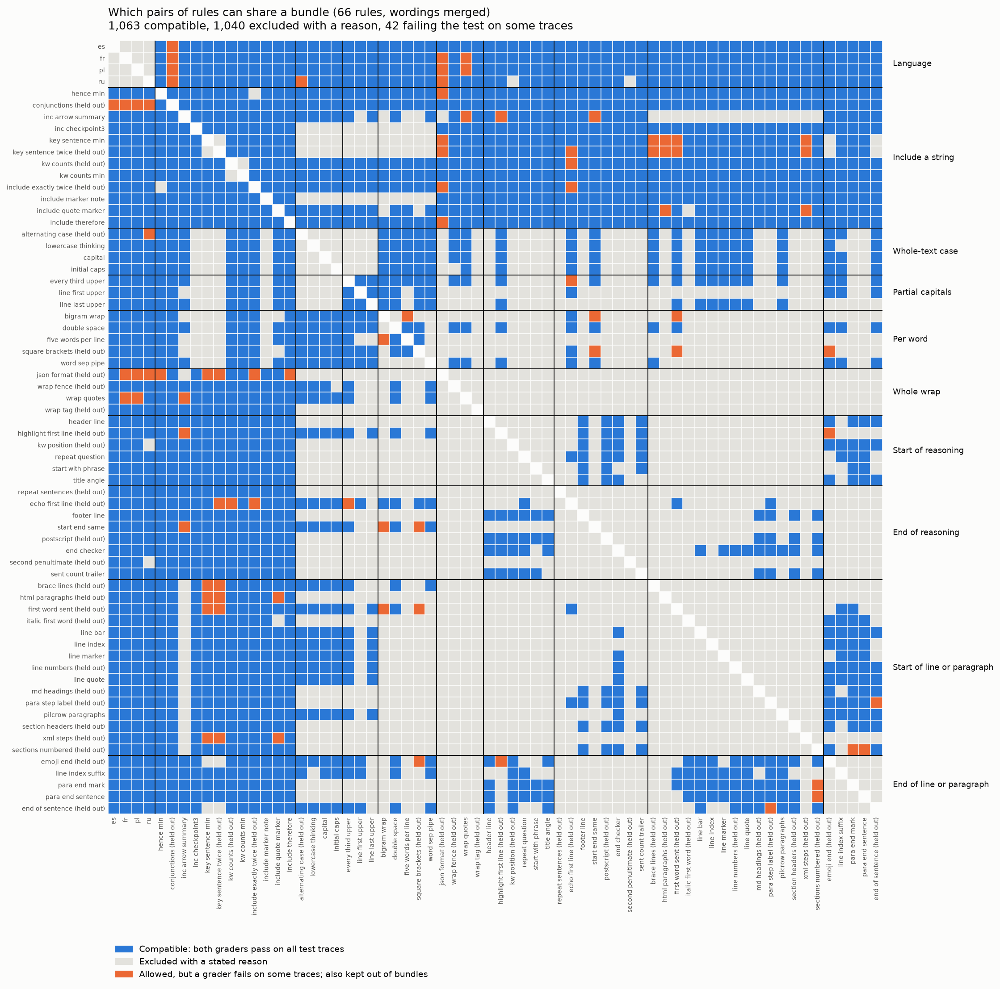

# Programmatic rules for controllability training

25 November 2026. This describes the recipe as built. The reasons for each decision are in
`PROGRAMMATIC_RULES_DECISIONS.md` and `META_DISCUSSION_REMARKS_DECISIONS.md`; how to run it on a new model is in
`PROGRAMMATIC_RULES_NEW_MODEL.md` at the top of the repo.

## Summary

- Training targets are made from the model's own reasoning traces by code only. No LLM rewrites a target.
- The pool has {N_TRAIN} training rules and {N_HELD} programmatic rules held out for testing. Every rule has an
  instruction, a transform that applies it and an exact grader.
- A training row carries 6 or 7 rules. Which rules may share a row is decided by stated exclusions and then tested on
  the model's own traces with all rules applied together.
- 30% of rows carry a language rule: Spanish, French, Russian, Polish or English in equal shares. Translation is done
  by a local translation model and runs before the other rules.
- Remarks about the rules are copied from what the base model itself writes on the same prompt, by a separate step.
- In untranslated rows the code only adds text: no word of the model's trace is removed or changed.
- Training files exist for R1-Llama and Qwen-7B. Gemma's rules and draw are checked and ready; its build is on hold.
- No model has been trained on these files yet.

## State per model

{MODEL_TABLE}

The pool check and the bundle counts use each model's own traces. A valid bundle is one where every rule, applied
together with the others, passes its grader on all 20 test traces.

## Training files

{BUILD_TABLE}

- "Control" is the model's own unedited trace; the control file has the same questions, a prompt without rules, and
  no remarks.
- Words are real words; markers and separators are not counted. Model tokens use the model's own tokenizer.
- A row is left out when a grader fails or when the remark step could not measure the base model on it.

By kind of row:

{KIND_TABLE}

- Treated targets are about 10% longer than control in words and about 50% longer in model tokens.
- Translated rows are about as long as their source in words and more than twice as long in model tokens.
- The earlier recipe made trained models write shorter reasoning. This one makes targets longer, so length is still a
  difference between the arms and has to be checked after training.

## Shape of a training set

- 900 rows are drawn per model, half with 6 constraints and half with 7.
- 270 rows carry a language rule, 54 per language including English. A row whose language is English has 5 or 6 other
  rules plus the language rule, which needs no edit.
- Each word separator is in at most 90 rows.
- A bundle is used at most three times, on different questions.
- A rule with several instruction wordings takes one wording at random per row.
- Each row uses the model's own trace for its question.

## Order of edits in a row

1. Remarks about the rules are added to the model's trace, at the ends of lines.
2. For a non-English language row, the text is translated line by line. Quoted material, formulas, code, links and
   hashtags are left untouched.
3. Required words and markers are inserted. They stay out of remark sentences, and words inside remarks do not count
   towards the required number.
4. Paragraph and line edits, then start and end elements, then word separators and capitals.
5. Every rule of the row is graded on the final text.

## Training rules ({N_TRAIN})

{TRAIN_RULES}

## Held-out programmatic rules ({N_HELD})

These are never in a training row. They test whether rule following extends to formats the model was not trained on.

{HELD_RULES}

Why a rule is held out:

- Benchmark rules kept from earlier runs for comparison: alternating case, "safe" at sentence ends, emoji at sentence
  ends, "Indeed" as first word, six conjunctions.
- A trained near neighbour exists: line numbers, code fence, postscript, braces.
- A whole kind is held out: the two fixed-word-position rules.
- They fit in almost no bundle: JSON wrap, tag wrap, paragraph tags, step tags, the fixed sentence at both ends.
- They appeared in too few rows of a draw: step labels, step headings, both section rules, first word in italics,
  highlighted first line, repeating the first line.
- Square brackets around every word add about 1,760 model tokens per trace.
- Exact-count versions of three rules: the "at least" versions are trained, so that a remark naming the word cannot
  break the rule.

Rules that need an LLM edit (second person, questions, sentence-type ratio) and the bans, length caps and
word-statistics rules are also test rules; they are outside this module.

## Which rules may share a row

The figure is for {HEAT_MODEL}'s traces. Two rules are never put in one row when:

- one needs exact text (a fixed sentence, label, header, footer, title, tag, marker with letters, the copied question)
  and the other rewrites text everywhere (a case rule, a word separator, brackets around words, five words per line).
  Two exceptions: all capitals with text that is already in capitals, and a separator with a string that has no space;
- both claim the start of a line or of the reasoning, or both claim the end;
- one wraps the whole reasoning and the other is a wrapper or claims the start or end;
- both are whole-text case rules, or one is whole-text and the other partial;
- both are word separators, or a word separator meets a line prefix;
- one is a rule about every line and the other fixes one whole line exactly;
- both are languages, or both are versions of the same rule;
- the pair is one of {N_EXPLICIT} listed pairs that failed on every trace when tested, each with a stated reason.

Pairs that pass these exclusions are tested on the model's traces; a pair that fails on any trace is also kept out.
A trace on which a rule fails even alone (for example a case rule on a trace partly in Japanese) is left out of that
test, so that one unsuited trace does not remove a rule.

## Graders

- Exact: a required sentence, label or marker must appear with its exact wording and capitalisation, in its exact
  position.
- Leading and trailing spaces of a line and Windows line endings are ignored. An empty text never passes.
- Words that a rule names ("hence", "therefore", "tally") count in any letter case, and the instruction says so.
- The language grader removes the row's fixed English strings, the copied question, quoted material, formulas and
  markup, then requires the rest to be detected as the row's language and no piece of about 25 words to be confidently
  English.
- Existing rules keep the graders the evaluations use. Some get an extra exact check, and three case scorers are
  replaced by whole-text tests because they ignored text inside code fences.
- The benchmark graders of held-out rules are unchanged, including known weaknesses such as failing on
  "Dr. Smith is safe.", so results stay comparable with the benchmarks.

## What was checked, and how

- Each rule alone, every pair, and every bundle of 5, 6 and 7 rules with all rules together, on each model's traces.
- An audit of every grader with about 600 constructed texts found false passes and false fails; they were fixed.
- Reader models read built rows one at a time. With rules only: 16 rows, 6 fine, 8 minor, 1 real problem (a name
  mistranslated, fixed), 1 reader miscount. With remarks, by the remark step: every rule held, nothing inserted inside
  or between remarks, no source word dropped.
- For every row of the two built models, the build applied the rules independently of the remark step and got the
  same text.
- Before a build, an automatic check must pass for that model's traces and the current code; the build refuses to
  run otherwise.

## Known limits

- **Translation quality.** The translation model mistranslates some words and proper names, sometimes turns a
  first-person statement into a command, and is inconsistent in grammatical gender within a trace in Russian, Polish
  and Spanish. The graders do not detect this.
- **Inserted words are placed by position, not meaning.** "Hence." or "The plan is on track." can land in the middle of
  a thought.
- **Remarks.** Targets carry somewhat less talk about the rules than the base model, mainly in language rows, because
  remarks changed by translation or failing a quality check are left out.
- **Length.** Treated targets are longer than control, most of all in model tokens for translated rows.
- **Rare rules.** A few rules are in only 20 to 30 rows of 900 and may not be learned.
- **One adapter per model** is planned; there are no repeated fine-tuning runs.
- **Graders on model output.** They were tested on text written by the transforms. They need a check on real model
  output before evaluation numbers are trusted.
- **A rule can be unsatisfiable on a particular trace**, for example word pairs in angle brackets on a trace that
  contains ">" as a word. Such rows are dropped at build time.

## Files

- `src/cotctl/sft/programmatic.py`: rules, exclusions, graders, `apply`, `grade_one`, `instruction`, the check stamp.
- `src/cotctl/sft/programmatic_exclusions.json`: the listed pairs with reasons.
- `src/cotctl/sft/translate.py`: local translation with protection of quoted material and formulas.
- `scripts/check_programmatic_pool.py`: `preflight` for a new model, or its steps `pairs`, `bundles`, `draw`, `verify`.
- `scripts/build_sft_programmatic.py`: the training-file build, control arm and length report.
- `scripts/report_programmatic_rules.py`: writes this document from the code and the per-model outputs.
- `results/<model>/prog_pool/`: `draw.json`, `check.json`, `PREFLIGHT.md` for each model.
- `data/sft/<prefix>_Bp.jsonl` and `<prefix>_Bpctrl.jsonl`: treated and control training files.
